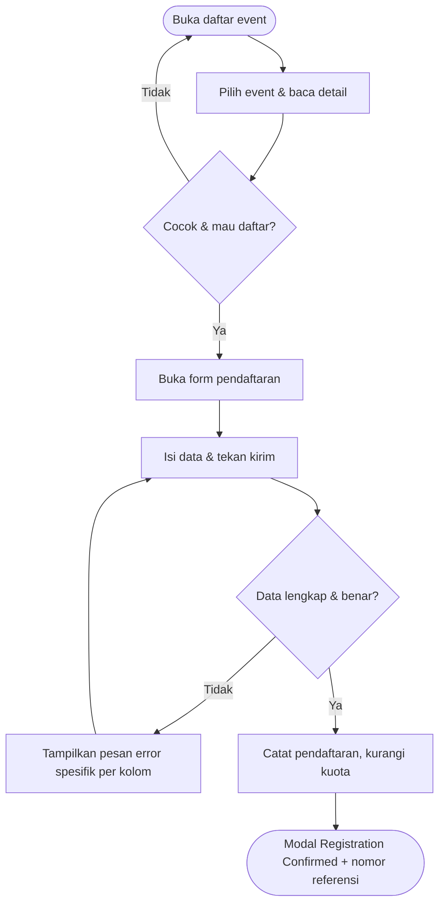

# Gatherly – Modul 5: User Flow & Interaction Flow

Yonathan Hezron – 102042300161

Alur pendaftaran peserta untuk aplikasi Gatherly (Vue 3 + Vue Router + Vite).

## Menjalankan

```bash
npm install
npm run dev
```

## Flowchart Pendaftaran Workshop



## Fitur

- `EventDetail` – tombol aksi berprioritas: Registration Closed → Already Registered (+ tautan tiket) → Sold Out → Register Now, memakai `router.push`.
- `EventRegistration` – layout dua kolom (`RegistrationSummary` + `RegistrationForm`), validasi per kolom, data valid tidak hilang saat error, dialog konfirmasi saat Cancel pada form yang sudah terisi.
- `AppModal` – named slot `footer`; `RegistrationReceipt` ditampilkan sebagai modal "Registration Confirmed".
- `EventCard` / `EventList` – lencana *Registered* reaktif.
- `YourEvents` & `TicketReceipt` – dompet tiket dan lembar tanda terima (rute `/browse/your-events` dan `/browse/your-events/:id`).
- `useEvents` – `registerAttendee`, `isUserRegistered`, `cancelRegistration`, dan penghapusan berantai tiket saat event dihapus; data tersimpan di `localStorage`.
- `main.css` – token `--space-5` (20px); `EventCreateForm` diselaraskan jaraknya.
